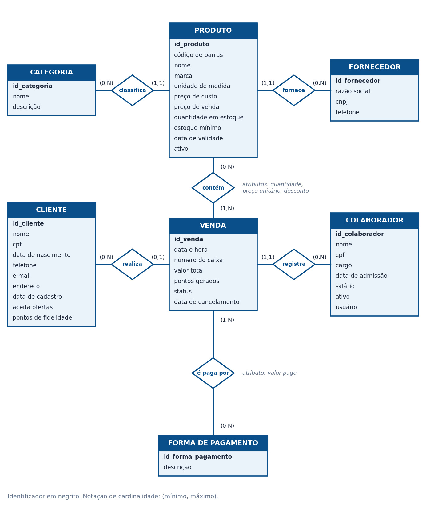
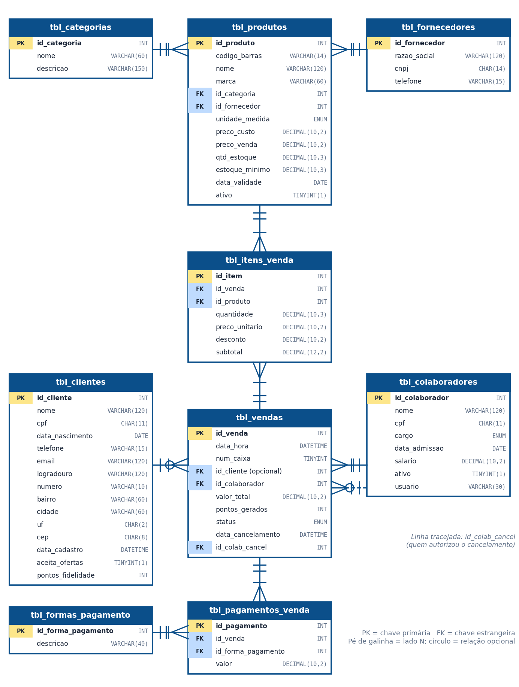

<div align="center">

# 🛒 Supermercado DB

**Banco de dados para um sistema de vendas de supermercado, com foco em fidelização de clientes.**


*Projeto acadêmico · UniFECAF · Análise e Desenvolvimento de Sistemas*

</div>

---

## 📌 Sobre o projeto

Os donos de um supermercado precisavam guardar, de forma segura, as informações de **produtos, colaboradores, clientes e vendas**. Com esse histórico, o mercado passa a conhecer as preferências de compra de cada cliente e consegue enviar ofertas direcionadas, **fidelizando** quem já compra na loja.

O projeto cobre o caminho completo, do problema ao banco funcionando:

1. **Levantamento de requisitos** com 12 perguntas ao proprietário e respostas simuladas
2. **Modelagem** conceitual, lógica e física
3. **Implementação em SQL** (MySQL), com triggers, dados de exemplo e consultas de fidelização
4. **Front-end de demonstração** que simula o comportamento do banco

🎥 **Vídeo de apresentação:** [assistir no YouTube](COLE_AQUI_O_LINK_DO_VIDEO)

---

## ✨ Funcionalidades

- Cadastro de clientes (opcional na venda, identificado por CPF), produtos, colaboradores, categorias e fornecedores
- Venda com **vários produtos**, preço praticado e desconto por item
- **Pagamento dividido** em mais de uma forma (dinheiro, débito, crédito, Pix, vale)
- **Baixa automática de estoque** e alerta de estoque mínimo
- **Programa de pontos** (1 ponto por real gasto), calculado por trigger
- Cancelamento de venda **sem apagar o histórico** (status, data e responsável)
- Consultas de fidelização: produtos mais comprados por cliente, ticket médio e clientes inativos há mais de 60 dias
- Consentimento para ofertas de marketing (LGPD)

---

## 🗂️ Estrutura do repositório

```
supermercado-db/
├── README.md
├── docs/
│   ├── Parte_Teorica_Levantamento_de_Requisitos.pdf
│   ├── Parte_Pratica_Modelagem_e_SQL.pdf
│   └── img/
│       ├── modelo-conceitual.png
│       └── modelo-logico.png
├── sql/
│   ├── script_mysql.sql        # entrega oficial (MySQL 8.0.16+)
│   └── script_sqlite.sql       # versão para testes (Letos / SQLiteStudio)
└── frontend/
    └── index.html              # demonstração do sistema de vendas
```

---

## 🧩 Modelagem

### Modelo conceitual



### Modelo lógico



### Tabelas

| Tabela | Função |
|---|---|
| `tbl_clientes` | Clientes identificados pelo CPF, com consentimento de ofertas e saldo de pontos |
| `tbl_produtos` | Produtos, preço, estoque, estoque mínimo, categoria e fornecedor |
| `tbl_colaboradores` | Funcionários; o operador de caixa é registrado em cada venda |
| `tbl_vendas` | Cabeçalho da venda: data e hora, caixa, operador, cliente, total, pontos e status |
| `tbl_itens_venda` | Produtos de cada venda, com quantidade, preço praticado e desconto |
| `tbl_pagamentos_venda` | Formas de pagamento usadas em cada venda |
| `tbl_formas_pagamento` | Formas de pagamento aceitas |
| `tbl_categorias` | Categorias de produtos |
| `tbl_fornecedores` | Fornecedores |

### Principais decisões

- **Preço guardado no item:** o preço do produto muda com o tempo, então a venda guarda o valor da época.
- **Tabelas de ligação:** `tbl_itens_venda` e `tbl_pagamentos_venda` resolvem os relacionamentos muitos-para-muitos.
- **Cliente opcional:** `id_cliente` aceita `NULL`, pois o cadastro não é obrigatório para comprar.
- **Vendas nunca são apagadas:** o cancelamento muda o status e registra data e responsável.
- **Triggers:** ao inserir um item, o estoque baixa e o total e os pontos da venda são calculados; os pontos são creditados ao cliente.

---

## 🚀 Como executar

### MySQL (versão oficial)

Requisito: **MySQL 8.0.16 ou superior** (a partir dessa versão as restrições `CHECK` são aplicadas).

```bash
mysql -u root -p < sql/script_mysql.sql
```

Ou, no **MySQL Workbench**: *File > Open SQL Script*, selecione `sql/script_mysql.sql` e execute tudo (ícone do raio). O script cria o banco `db_supermercado`, as tabelas, os triggers, os dados de exemplo e as consultas.

> No phpMyAdmin, o `DELIMITER` deve ser configurado no campo "Delimitador" da tela SQL, e os triggers executados separadamente.

### SQLite (apenas para testes)

Para quem usa Letos ou SQLiteStudio, abra um banco novo, cole o conteúdo de `sql/script_sqlite.sql` e execute o script inteiro. Também funciona pela linha de comando:

```bash
sqlite3 supermercado.db < sql/script_sqlite.sql
```

### Front-end de demonstração

Abra o arquivo `frontend/index.html` em qualquer navegador. Não precisa instalar nada.

---

## 💻 Front-end de demonstração

Interface criada para visualizar o funcionamento do banco. Ela **simula o comportamento do banco no navegador** (não está conectada ao MySQL) e usa os mesmos dados de exemplo do script.

- **Nova venda:** escolha caixa, operador e cliente, adicione produtos, divida o pagamento e finalize
- **Estoque:** acompanhe a baixa a cada venda e o alerta de reposição
- **Vendas:** histórico com opção de cancelar sem apagar
- **Fidelização:** pontos, compras, ticket médio e produto mais comprado de cada cliente
- **SQL executado:** painel que mostra os comandos `INSERT` e `UPDATE` de cada ação, incluindo os triggers

Os dados ficam no `localStorage` do navegador. O botão **Reiniciar dados de exemplo** restaura o estado inicial.

---

## 🔎 Consultas de fidelização

O script traz quatro consultas prontas, entre elas:

```sql
-- Produtos mais comprados por cada cliente (base para ofertas direcionadas)
SELECT c.nome AS cliente, p.nome AS produto,
       SUM(i.quantidade) AS qtd_total,
       COUNT(DISTINCT v.id_venda) AS compras
  FROM tbl_vendas v
  JOIN tbl_clientes c     ON c.id_cliente = v.id_cliente
  JOIN tbl_itens_venda i  ON i.id_venda   = v.id_venda
  JOIN tbl_produtos p     ON p.id_produto = i.id_produto
 WHERE v.status = 'CONCLUIDA'
 GROUP BY c.id_cliente, c.nome, p.id_produto, p.nome
 ORDER BY c.nome, qtd_total DESC;
```

### Resultado esperado dos dados de exemplo

| Venda | Total | Pontos | Cliente |
|---|---|---|---|
| 1 | R$ 71,33 | 71 | Ana Paula Ferreira |
| 2 | R$ 27,95 | 27 | João Pedro Santos |
| 3 | R$ 33,88 | 33 | não identificado |
| 4 | R$ 27,95 | 27 | Ana Paula Ferreira |

Saldo final de pontos: Ana Paula = 98 e João Pedro = 27.

---

## 🛠️ Tecnologias

- **MySQL 8**: modelo físico, triggers, restrições e índices
- **SQLite**: versão de testes
- **HTML, CSS e JavaScript** puros: front-end de demonstração

---

## ⚠️ Limitações e próximos passos

- O cancelamento de uma venda ainda não devolve o estoque nem estorna os pontos automaticamente.
- O front-end não está integrado ao MySQL. Uma evolução natural é criar uma API (Node.js ou PHP) entre a interface e o banco.
- Controle completo de compras e entrada de mercadorias dos fornecedores.

---

## 👤 Autor

**Denilson Almeida Rocha**
Estudante de Análise e Desenvolvimento de Sistemas · UniFECAF

[](https://linkedin.com/in/denilson-almeida-ads)
[](https://github.com/Merovinci)
